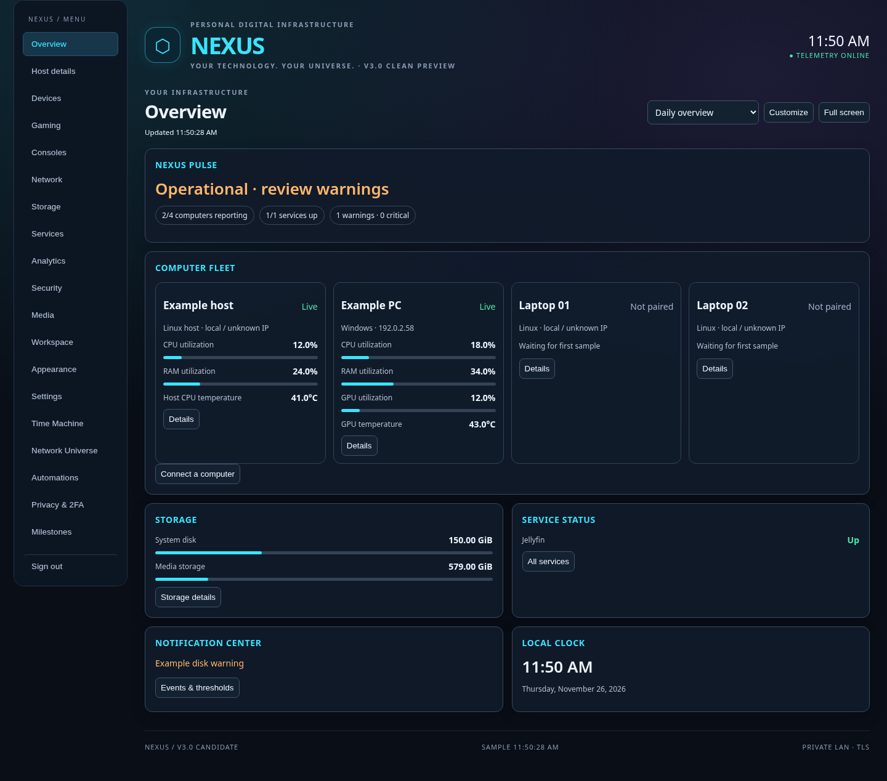

# NEXUS: your own home infrastructure dashboard

NEXUS is a dashboard you host yourself. It shows how your Linux server and your other computers are doing (CPU, memory, disk, network and more) on one page in your web browser. It runs on your own machine and needs no cloud account. Your data stays at home.

> **Status:** 3.0 developer preview. It works, but it is still young. Use it on your home or lab network only. Never expose it to the public internet.



*The screenshot uses made-up sample data.*

---

## What it does

- **Overview page** with widgets you can rearrange, saved dashboard profiles and color themes.
- **Live host metrics** for the Linux machine that runs NEXUS: CPU (per core), memory, disk space and activity, network traffic, uptime and swap.
- **Connect other computers** with a one-time pairing code. Each paired computer sends its stats to NEXUS over HTTPS.
  - **Linux agent**: a small Python script.
  - **Windows agent**: a native program that NEXUS builds for you (unsigned developer build).
- **History and comparisons** ("Time Machine"), so you can look back and compare devices.
- **Alerts and rules**, for example when a disk is too full or a CPU runs too hot.
- **Network map** and optional discovery of devices on your local network (off by default).
- **Security built in**: owner password, optional two-factor codes (any authenticator app), recovery codes, HTTPS with its own private certificate, and strict login rate limits.
- **Optional extras**: weather, and service status from [Uptime Kuma](https://github.com/louislam/uptime-kuma). Both are off until you turn them on.
- **A command-line helper** (`manage.py`) to set up, start, stop, back up, repair and uninstall.

---

## What you need

The **NEXUS server** runs on **Linux** only, because it reads its stats from Linux system files. You can then open the dashboard from any computer or phone on your network, including Windows and macOS.

| You need | Why |
|---|---|
| A Linux machine (a home server, mini PC, Raspberry Pi-class box or VM) | This is where NEXUS runs |
| **Python 3.11 or newer** | Runs the setup helper |
| **OpenSSL** | Makes the private HTTPS certificates |
| **Docker Engine with Docker Compose v2** | NEXUS runs inside a container |
| `git` (optional) | To download the code |

Tested for this guide on Debian 13 with Python 3.13, OpenSSL, and Docker 26 with Compose 2.26.

> **Heads up:** a user who can run Docker has a lot of power on the machine. Use a trusted admin account for this, not a shared account.

---

## Install (Linux server)

### 1. Install the tools

On **Debian or Ubuntu**:

```bash
sudo apt update
sudo apt install -y python3 openssl git curl
```

Then install Docker Engine and the Compose plugin by following Docker's official guide for your distribution: https://docs.docker.com/engine/install/

Let your normal user use Docker without `sudo` (then **log out and log back in**):

```bash
sudo usermod -aG docker "$USER"
```

Check that everything is ready:

```bash
python3 --version     # should be 3.11 or newer
docker compose version
docker ps             # should print a table header, not "permission denied"
```

### 2. Download NEXUS

```bash
git clone https://github.com/bluestudiolabs/nexus.git
cd nexus
```

(Or download the ZIP from GitHub, extract it, and `cd` into the folder.)

### 3. Run the setup

Run this as your **normal user**, not as root:

```bash
python3 manage.py setup
```

It will ask you:

1. **Server IPv4 address.** Press Enter for `127.0.0.1`. That means only this machine can open the dashboard, which is a safe way to try it out.
2. **Owner password.** At least **14 characters**. You type it twice.

Setup then creates a private `.nexus/` folder with your certificates, password hash and settings, builds the container and starts it. When it finishes, it prints something like:

```
Server: https://127.0.0.1:3010
Public CA: /home/you/nexus/.nexus/ca/ca.crt
sha256 Fingerprint=1C:B8:8A:...
```

### Want to reach it from other computers on your network?

Use the server's own private network address. The values below are **examples only**, so replace them with yours. You can find yours with `ip -br addr`.

```bash
python3 manage.py setup --address 192.168.1.50 --port 3010 --lan 192.168.1.0/24 --interface eth0
```

Only private addresses (`127.x`, `10.x`, `172.16-31.x`, `192.168.x`) are allowed, on purpose.

---

## Open the dashboard

1. Open the printed address, for example `https://127.0.0.1:3010`, in your browser.
2. Your browser will warn you that the certificate isn't trusted. That is expected, because NEXUS made its **own private certificate authority (CA)**. To remove the warning properly, import the file `.nexus/ca/ca.crt` into your browser or operating system as a trusted certificate authority. First check that its fingerprint matches the one setup printed.
   - Only ever share **`ca.crt`**. **Never** share `ca.key` or anything else in `.nexus/`.
3. Sign in with your owner password.
4. The overview starts empty. That's normal.

You can test from the server's command line too:

```bash
curl --cacert .nexus/ca/ca.crt https://127.0.0.1:3010/
```

---

## Connect your computers

In the dashboard, go to **Devices → Register computer**. Give it a name, then create a **pairing code**. Each code works once.

### Linux computer

1. In **Devices**, download the **Linux agent ZIP** and extract it on the computer you want to watch.
2. Copy the server's `ca.crt` to that computer.
3. Run this as your normal user (it needs a working user systemd session):

   ```bash
   bash setup-linux.sh install
   ```

4. Answer the prompts: the NEXUS address (for example `https://192.168.1.50:3010`), the path to `ca.crt`, and the pairing code.

The agent then sends a sample about every 10 seconds. To remove it, run `bash setup-linux.sh uninstall`, then also delete the device in the NEXUS dashboard.

### Windows computer

1. In **Devices**, download **NEXUS-Agent-Setup-x64.exe**.
2. Run it and enter the NEXUS address, the pairing code, and optionally the `ca.crt` file.
3. It starts automatically when you sign in to Windows.

> The Windows agent is an **unsigned developer build**. Windows Smart App Control or SmartScreen may block it. Don't turn off Windows protections to get around this. See [docs/RELEASE.md](docs/RELEASE.md).

### macOS

There is no macOS agent yet. You can still open the dashboard in Safari, Chrome or Firefox on a Mac.

---

## Everyday commands

Run these from the NEXUS folder:

| Command | What it does |
|---|---|
| `python3 manage.py status` | Is it running? |
| `python3 manage.py doctor` | Health check: certificates, container, and whether the website answers |
| `python3 manage.py stop` | Stop NEXUS |
| `python3 manage.py start` | Start it again |
| `python3 manage.py repair` | Rebuild and restart, for example after editing settings or updating the code |
| `python3 manage.py backup` | Make a private backup file (`nexus-backup-....tar.gz`) |
| `python3 manage.py collect` | Collect extra host info once (failed services, SMART, etc.) |
| `python3 manage.py collector-enable` | Collect that info every couple of minutes (needs user systemd) |
| `python3 manage.py uninstall --dry-run` | Show what uninstalling would remove, without doing it |
| `python3 manage.py uninstall --keep-data` | Remove the container but keep your data |
| `python3 manage.py uninstall --purge` | Remove everything NEXUS created (asks you to type `DELETE NEXUS`) |

> Backups contain your **private keys and login data**. Keep them safe and never upload them anywhere public.

---

## Configuration

Setup writes your real settings to **`.nexus/config.env`**. That file is private and is never committed to Git. The file [`.env.example`](.env.example) shows the main options with safe defaults, for reference only. You don't need to copy it, because setup creates the real file for you.

After you edit `.nexus/config.env`, apply the change with:

```bash
python3 manage.py repair
```

| Setting | Default | What it means |
|---|---|---|
| `NEXUS_BIND` / `NEXUS_PORT` | `127.0.0.1` / `3010` | Address and port of the dashboard (set during setup) |
| `NEXUS_LAN` | your address `/32` | The private network NEXUS considers "home" |
| `NEXUS_INTERFACE` | auto | Network card to watch, for example `eth0` |
| `NEXUS_DISCOVERY` | `0` | `1` = look for devices on your LAN (needs an interface and a network of /20 or smaller) |
| `NEXUS_GATEWAY` | empty | Your router's address, to test it |
| `NEXUS_INTERNET_PROBE` | `0` | `1` = also test internet connectivity |
| `KUMA_URL`, `KUMA_SLUG` | empty | Your Uptime Kuma address and status-page name, if you use it |
| `NEXUS_SMART_DEVICES`, `NEXUS_SERVICES` | empty | Disks and services the collector should check (space-separated) |

Don't put passwords or keys in these files. NEXUS keeps those in `.nexus/` separately.

Weather is turned on from inside the dashboard (Security settings), with coordinates you enter yourself.

---

## Troubleshooting

These are real errors seen while testing:

**`NEXUS: [Errno 2] No such file or directory: 'docker'`**
Docker isn't installed, or isn't on your PATH. Install Docker Engine (see step 1). If you used `--prepare-only`, your settings are already created, so just run `python3 manage.py repair` afterwards.

**`permission denied while trying to connect to the Docker daemon socket at unix:///var/run/docker.sock`**
Your user can't use Docker yet. Run `sudo usermod -aG docker "$USER"`, then log out and back in.

**`NEXUS: Password invalid or mismatch`**
The password is shorter than 14 characters, or the two entries didn't match. Run setup again.

**`NEXUS: Use loopback or RFC1918 IPv4; public binding is not supported`**
You entered a public IP address. Use `127.0.0.1` or your private LAN address (for example `192.168.x.x`).

**`NEXUS: Runtime already exists; use start or repair, never overwrite existing credentials`**
NEXUS is already set up in this folder. Use `python3 manage.py start` or `repair`. To really start over, first run `python3 manage.py uninstall --purge`.

**`NEXUS: [Errno 2] No such file or directory: '.../.nexus/installation.json'`**
You ran a command like `status` before setup. Run `python3 manage.py setup` first.

**The browser says "Your connection is not private."**
That's expected until you trust `.nexus/ca/ca.crt` (see "Open the dashboard"). Check the fingerprint first.

**The agent downloads in Devices don't work (HTTP 400)**
That happens if you started `secure.py` directly instead of through Docker. The agent files are only built inside the Docker image, so use `python3 manage.py setup` or `repair`.

---

## For developers

Everything is written with the Python standard library, plain JavaScript, and Go for the Windows agent. You don't need `pip install` to run the tests.

```bash
python3 -m unittest discover -v                 # 19 backend tests
for f in *.js; do node --check "$f"; done       # JavaScript syntax check
(cd agents/windows && go test ./...)            # Windows agent protocol tests (Go 1.23+)
```

Optional browser smoke test (uses fake data):

```bash
python3 -m venv .venv && .venv/bin/pip install playwright && .venv/bin/playwright install chromium
.venv/bin/python ui_test.py
```

More technical detail, including security notes, agent internals and the project layout, is in [docs/ADVANCED.md](docs/ADVANCED.md), [SECURITY.md](SECURITY.md) and [agents/windows/README.md](agents/windows/README.md).

---

## Contributing

Ideas, bug reports and pull requests are welcome. Please read the [Blue Studio Labs contributing guide](https://github.com/bluestudiolabs/.github/blob/main/CONTRIBUTING.md) and this project's [CONTRIBUTING.md](CONTRIBUTING.md). Never include real IPs, keys, databases or logs in issues or pull requests.

## License

NEXUS is free and open source under the [MIT License](LICENSE).

Found a security problem? Please report it privately through the repository's **Security** tab → **Report a vulnerability**, not in a public issue.
